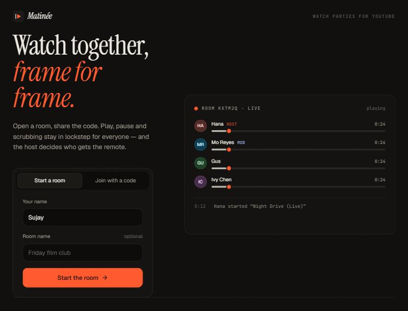
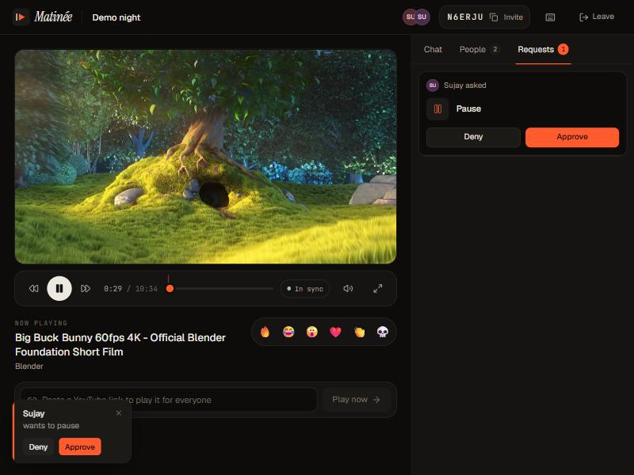
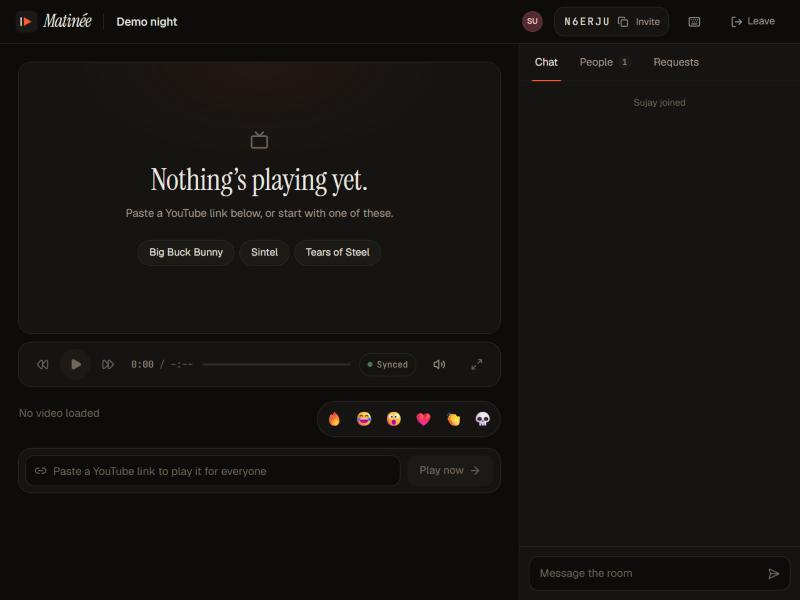
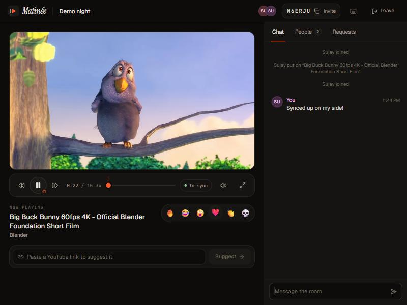

# Matinée — YouTube Watch Party

Watch YouTube together, in sync. Create a room, share the code or link, and everyone sees the same moment. Play, pause, seek and video changes are synced over WebSockets, and roles decide who controls playback.

**Live URL:** https://matinee-1.onrender.com  
_(Render free tier: the first load after the app has been idle can take about 30–50 seconds while it wakes up.)_

**Docs:** [Run locally](#run-locally) · [Architecture & WebSocket flow](#architecture) · [Code walkthrough guide](docs/WALKTHROUGH.md) · [Demo](#demo) · [Deploy](#deploy)

## Demo

| Landing | Host: participant asks to pause |
|---|---|
|  |  |
| **Empty room (host)** | **Second tab: joined late, in sync, chatting** |
|  |  |

To try it yourself, open the live URL in two browser tabs: create a room in one, and paste the invite link in the other.

---

## Features

| Requirement | How it's handled |
|---|---|
| Real-time sync (play/pause/seek/video) | Server-authoritative playback clock, broadcast with `sync_state`. Clients correct drift every second. |
| Room model | `POST /api/rooms` → 6-char code (no ambiguous characters). Join by code or `/r/CODE` link. |
| YouTube integration | IFrame Player API with native controls hidden; our own transport bar drives it. |
| WebSockets | Socket.IO over the WebSocket transport, with typed events shared by client and server. |
| Roles | Host / Moderator / Participant / Viewer. Every event is permission-checked **on the server**. |
| Host powers | Assign roles, remove participants, transfer host. |
| Participant requests | When a participant presses play/pause, scrubs, or pastes a link, it becomes a **request** that the host or a moderator approves or denies. Requests expire after 60s. |
| Chat (bonus) | Chat with history, grouped messages, and system notices. |
| Reactions (bonus) | Floating emoji reactions. Each one is pinned to the video time and shown as a "heat strip" above the timeline. |
| Persistence (bonus) | Rooms and playback state are saved in SQLite (`node:sqlite`, so there's no native build step) and reloaded after a restart. |
| OOP server (bonus) | `Room`, `Participant`, `RoomManager`, `RoomGateway`, and `RoomRepository` classes. |

Other details: if a host drops, they keep their seat and role for 20s (refreshing the page is safe). If the host leaves, the room automatically picks a new host (moderators first). If autoplay is blocked, the player shows a "Join the playback" prompt. Keyboard shortcuts: `Space`/`K`, `←`/`→`, `J`/`L`, `M`, `F` (press `?` for the list). CI runs typecheck, tests and build on every push. Payloads are validated with zod, rate limits are applied per connection, and reduced-motion preferences are respected.

## Run locally

Requires **Node 24+** (npm 11 — the lockfile needs it).

```bash
npm install
npm run dev        # API on :3001, Vite on :5173 (proxies /api and /socket.io)
```

Open http://localhost:5173. To test multiple users, open more tabs. Each tab is a separate person because seats are tracked in `sessionStorage`.

```bash
npm test           # 33 tests: domain rules + end-to-end over real sockets
npm run typecheck
npm run build && npm start   # production: one server on :3001 serves API, sockets and the SPA
```

## Architecture

```
client (React + Vite)                          server (Node + Express + Socket.IO)
┌───────────────────────────┐   WebSocket     ┌───────────────────────────────────┐
│ useRoomSession            │◀──────────────▶│ RoomGateway   (validate → rate     │
│  · join / resume seat     │  typed events   │               limit → seat → act → │
│  · events → zustand store │                 │               broadcast)           │
│ useSyncedPlayer           │                 │ Room          (rules, roles,       │
│  · applies sync_state     │   REST          │               playback clock)      │
│  · drift correction       │◀──────────────▶│ RoomManager   (lifecycle, eviction)│
│ usePlaybackIntent         │  /api/rooms     │ RoomRepository(SQLite | memory)    │
│  · act directly or request│                 └───────────────────────────────────┘
└───────────────────────────┘
shared/  protocol.ts (event types) · roles.ts (permission matrix) · youtube.ts (URL parsing)
```

### How WebSockets keep everyone in sync

1. **The server owns the clock.** Playback is stored as `{ videoId, playing, position, updatedAt, seq }`. While a video is playing, the current time is `position + (now − updatedAt)`, so the server never needs to "tick".
2. **Controls send intent, not state.** When the host clicks pause, the client emits `pause { time }`. The server checks the sender's role, updates the clock, increments `seq`, and broadcasts `sync_state` to the whole room, including the sender.
3. **Clients converge.** Each client estimates its offset from the server clock (NTP-style `time_sync` pings; the sample with the lowest round-trip time wins). With that offset it computes where the video *should* be, and seeks if it is more than 0.75s off. A drift loop repeats this every second, which also catches buffering, ads and backgrounded tabs.
4. **No echo loops.** The iframe never receives input (native controls are off and a click shield sits over it). That means player state events never get re-broadcast, which avoids the classic watch-party feedback loop.
5. **Late joiners and reconnects.** `join_room` returns a full snapshot (participants, playback, chat, open requests, reaction moments). After any reconnect, the client re-joins with its session token and gets the same seat and role back.

### Role-based access on the backend

`shared/roles.ts` defines a permission matrix (`playback`, `change_video`, `assign_role`, `remove_participant`, `transfer_host`, `resolve_requests`, `request`, `chat`, `react`). Every mutating method on `Room` calls `require(actor, permission)` before it does anything. The client uses the same matrix only to disable UI it already knows is forbidden. Approving a request runs the action **with the approver's authority**, so it goes through the same permission check.

Identity: the creator gets a one-time `hostKey` from `POST /api/rooms`, and claiming it on join makes them Host. Every joiner then receives an unguessable `sessionToken` that is used to resume their seat. Removed users' tokens are banned for that room.

### WebSocket events

Client → server: `join_room`, `leave_room`, `play`, `pause`, `seek`, `change_video`, `assign_role`, `remove_participant`, `transfer_host`, `request_action`, `resolve_request`, `cancel_request`, `chat_send`, `reaction`, `time_sync`, `request_sync`

Server → client: `sync_state`, `user_joined`, `user_left`, `presence`, `role_assigned`, `participant_removed`, `removed`, `session_replaced`, `request_created`, `request_resolved`, `chat_message`, `reaction`, `error_event`

All client events use acknowledgements: `{ ok: true }` or `{ ok: false, code, message }`.

## Deploy

### Render (recommended — single service)

1. Push this repo to GitHub.
2. In Render, choose **New → Blueprint** and pick the repo. `render.yaml` configures everything:
   - Build: `npm ci --include=dev && npm run build`
   - Start: `npm start`
   - Health check: `/api/health`
3. Put the resulting URL at the top of this README (currently deployed at https://matinee-1.onrender.com).

One service serves the API, the WebSocket endpoint and the built SPA, so there's no CORS to configure and only one URL to share.

### Split hosting (Netlify/Vercel frontend + Render/Railway backend)

Set `CORS_ORIGINS=https://your-frontend.app` on the server, and set `VITE_SERVER_URL=https://your-api.onrender.com` when building the client.

### Environment variables

See `.env.example`. Important: `PORT`, `DATABASE_PATH` (`off` keeps everything in memory only), `CORS_ORIGINS`, `MAX_PARTICIPANTS_PER_ROOM`, `RECONNECT_GRACE_MS`, `REQUEST_TTL_MS`.

## Trade-offs and known limits

- **Single instance.** Live membership lives in memory. Scaling out needs the Socket.IO Redis adapter for broadcasts, plus moving room state to Redis (or sticky sessions per room). Persistence is already behind the `RoomRepository` interface.
- **Render free tier** has an ephemeral disk and sleeps when idle. Rooms survive in-process restarts but not redeploys. Attach a disk, or swap in Postgres behind `RoomRepository`.
- **Moderator roles aren't persisted** across server restarts, only the host. Membership is deliberately live state.
- **Drift tolerance is 0.75s.** YouTube only offers coarse playback rates, so small drift is corrected with a seek rather than a speed change.
- **Some videos block embedding** (owner setting). The player shows a clear message, and staff can pick another video.
- **Removal is per seat.** A removed user could open a fresh tab under a new name. Real bans would need authentication.
